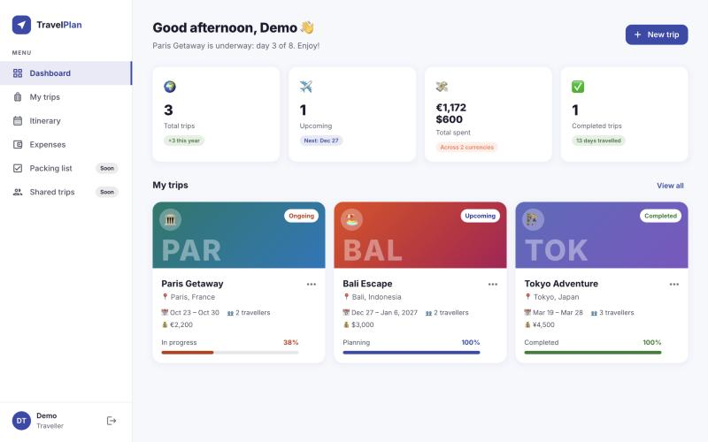
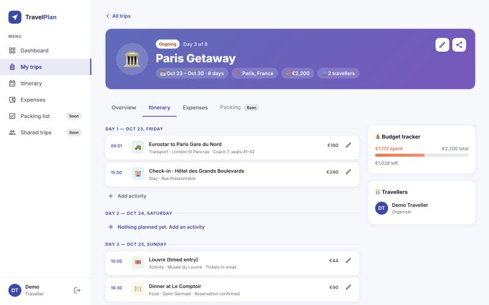
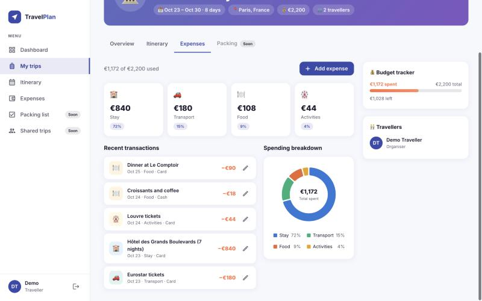
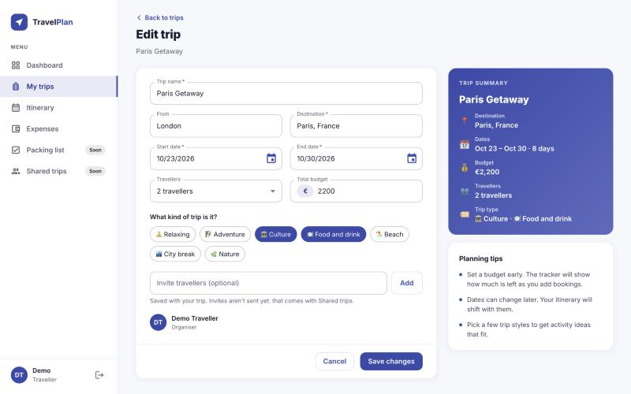
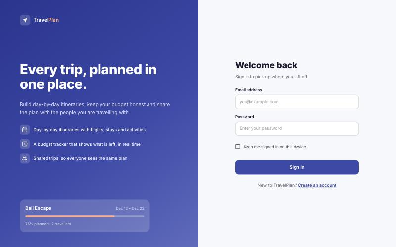
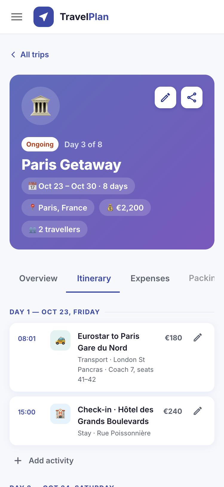

# TravelPlan

A travel planner web app: create trips, plan them day by day, track spending against a budget,
and keep the people you're travelling with in the loop. React + TypeScript on the frontend,
Spring Boot + PostgreSQL on the backend
([travel-planner-api](https://github.com/Sreelekha2408/travel-planner-api)), with cookie-based
authentication.

> Built with React and Spring Boot; used Claude for code review, debugging and test generation.

## Screenshots

| Dashboard | Trip itinerary |
| --------- | -------------- |
|  |  |

| Expenses | Plan a trip |
| -------- | ----------- |
|  |  |

| Sign in | Mobile |
| ------- | ------ |
|  |  |

## Features

- **Accounts**: sign up, sign in, "Keep me signed in" (7-day session), sign out
- **Secure sessions**: the JWT lives in an HttpOnly cookie (never readable by JavaScript), with
  CSRF protection; see [docs/AUTH.md](docs/AUTH.md)
- **Trips**: create, edit and delete trips with dates, budget and currency, travellers, trip
  types and invited travellers; a live summary card while filling in the form, and a
  "Discard changes?" prompt before leaving unsaved edits
- **Itinerary**: a day-by-day plan for every trip; add, edit, move and delete activities inline
  (flights, stays, food, activities, transport), with times and costs
- **Expenses**: log spending per trip, see the biggest categories, an interactive spending
  breakdown chart, and a budget tracker that turns red when you go over
- **Dashboard**: a time-of-day greeting with what's happening now or next, and stat cards for
  trips, upcoming trips, spending (per currency) and days travelled
- **Travellers and invites**: invite people by email (saved, not yet emailed); the traveller
  count always covers you plus everyone invited
- **Validation** on both sides: the form validates as you type, and the API re-checks every rule
  and reports all problems at once
- **Loading, empty and error states** for every data view, with retry
- **Responsive layout**: permanent sidebar on desktop, slide-in menu on phones
- **Accessibility**: labelled inputs, real headings and lists, keyboard-friendly controls, live
  regions for dynamic messages, and charts that never rely on colour alone

## Tech stack

| Area | Choices |
| ---- | ------- |
| Frontend | React 19, TypeScript, Vite 8, React Router 7 (data router) |
| UI | MUI 9 with a custom theme (design palette, Inter font), MUI X Date Pickers, MUI X Charts, dayjs |
| Data | TanStack Query (caching, cache invalidation after every change) |
| Forms | react-hook-form |
| Tests | Vitest, React Testing Library, jsdom |
| Backend | Java 17, Spring Boot 3.5, Spring Security 6.5, Spring Data JPA, Bean Validation, PostgreSQL, Liquibase, JJWT |

## Running locally

### Prerequisites

- **Node.js 22** (see `.nvmrc`; with nvm: `nvm use`) and **npm 11**
- For the real backend: **Java 17** and **PostgreSQL** (see the
  [backend README](https://github.com/Sreelekha2408/travel-planner-api))

### Frontend

```bash
npm install
npm run dev        # http://localhost:5173, proxies /api to the backend on :8080
```

Without a backend, use the built-in mock API: auth with real HttpOnly cookies, plus in-memory
trips, itineraries and expenses with sample data. The test account is defined in
`mock-api/mockApi.ts`.

```bash
npm run dev:mock
```

Other scripts:

```bash
npm test           # Vitest in watch mode
npm run test:run   # run the tests once
npm run lint
npm run build      # type-check and production build into dist/
```

## How the frontend talks to the backend

In development the browser only talks to `localhost:5173`. Vite proxies `/api/*` to Spring Boot
and strips the prefix, so requests are same-origin: cookies are first-party and no CORS setup is
needed. Every request goes through `apiFetch` (`src/services/serviceWrapper.ts`), which sends
cookies, adds the CSRF header to POST/PUT/DELETE requests, and turns any 401 into "signed out".

### API endpoints used

| Method | Endpoint | Purpose |
| ------ | -------- | ------- |
| `POST` | `/users/signup` | Create an account |
| `POST` | `/users/login` | Sign in; sets the HttpOnly `access_token` cookie |
| `GET` | `/users/me` | Who is signed in (restores the session on page load) |
| `POST` | `/users/logout` | Sign out; expires the cookie |
| `GET` | `/trip/list` | The signed-in user's trips |
| `GET` / `PUT` / `DELETE` | `/trip/{id}` | One trip (404 if it doesn't exist or isn't yours) |
| `POST` | `/trip/create` | Create a trip |
| `GET` / `POST` | `/itineraries/{tripId}` | A trip's itinerary / add activities |
| `PUT` / `DELETE` | `/itineraries/{itemId}` | Edit or delete an activity |
| `GET` / `POST` | `/expenses/{tripId}` | A trip's expenses (newest first) / add one |
| `PUT` / `DELETE` | `/expenses/{expenseId}` | Edit or delete an expense |

## Project structure

```
src/
  common/        theme, trip/itinerary/expense helpers, password rules (+ unit tests)
  components/
    common/      shared pieces (dialog title, trip picker row)
    dashboard/   greeting, stat cards, trip overview
    expenses/    Expenses tab, form, chart, budget tracker, trip picker page
    itinerary/   Itinerary tab, inline activity form, trip picker page
    layout/      app shell (sidebar, mobile menu), logo, loader, coming-soon page
    routing/     ProtectedRoute
    signin/      sign-in page and form
    signup/      create-account page and form
    trips/       trip list, cards, form, detail page, share and delete dialogs
  context/       AuthProvider and useAuth (auth state: loading | unauthenticated | authenticated)
  services/      apiFetch, API calls per resource, TanStack Query hooks
  test/          test setup and renderWithProviders
mock-api/        dev-only mock API for `npm run dev:mock`
docs/            how cookie-based auth works (AUTH.md), screenshots
```

## Design decisions

- **HttpOnly cookie instead of localStorage** for the JWT, so XSS can't steal it, plus Spring's
  double-submit CSRF token. The full reasoning, request flow and gotchas are in
  [docs/AUTH.md](docs/AUTH.md).
- **Ownership on the server**: every trip, itinerary and expense endpoint checks that the data
  belongs to the signed-in user, and answers 404 (not 403) for someone else's, so ids can't be
  probed.
- **Validation in two layers**: react-hook-form for instant feedback; Bean Validation
  annotations on the API's request classes for single-field rules, and service code for rules
  that compare fields (end date after start, travellers covering everyone invited).
- **Money never mixes currencies**: each trip has an ISO 4217 currency, expenses use it, and the
  dashboard totals spending per currency instead of adding euros to dollars.
- **Auth state as a status union** (`loading | unauthenticated | authenticated`) instead of
  `user + isLoading`, so impossible combinations can't be represented.
- **TanStack Query** for server state: each resource has its own query keys, every change
  invalidates them so all views refresh themselves, and the cache is cleared on sign-out.
- **Tabs with real URLs** (`/trips/:id/itinerary`, `/trips/:id/expenses`) so Back, refresh and
  links keep the tab.
- **Code splitting**: every page except sign-in is lazy-loaded, React and MUI get separate,
  cacheable vendor chunks, and heavy libraries (date pickers, charts) only download with the
  screen that needs them.
- **A typed MUI theme** holds every design colour; components use theme paths such as
  `color: "text.secondary"` rather than hex values. Chart colours come from a palette checked for
  colour-blind readers.

## Roadmap

- [ ] Packing list
- [ ] Shared trips: email invites and give invitees access (invites are saved, not sent, today)
- [ ] Profile page with a profile picture
- [ ] Google sign-in and "Forgot password"
- [ ] Refresh tokens, so "Keep me signed in" doesn't rely on a long-lived JWT
- [ ] Backend tests, end-to-end tests (e.g. Playwright) and CI
- [ ] Deployment with the SPA and API on the same site
- [ ] Mobile app (React Native) using `Authorization: Bearer` alongside the web app's cookies
